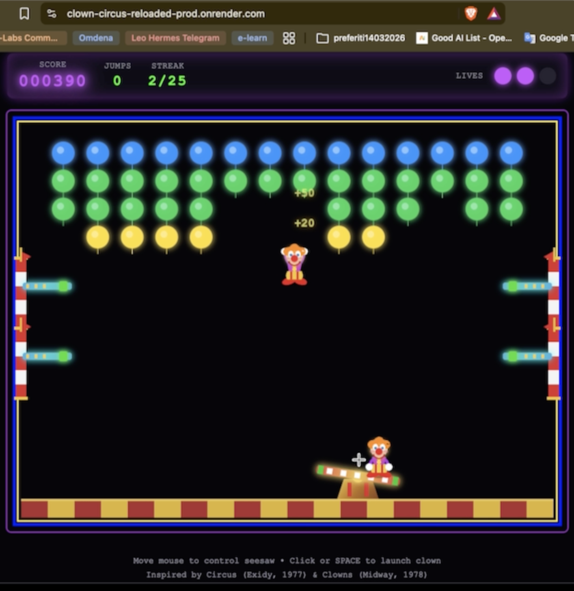
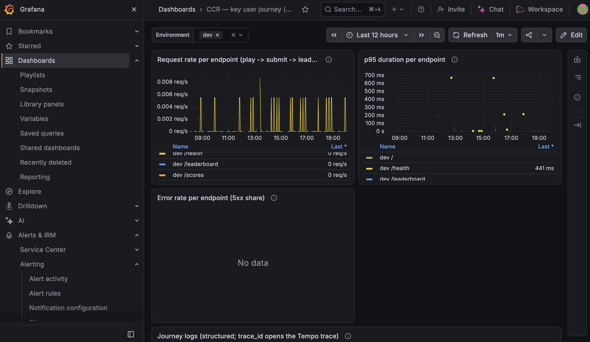
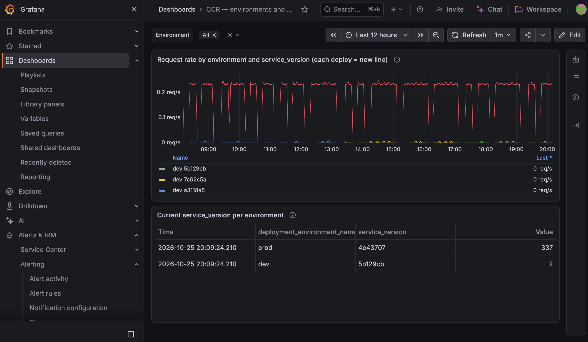
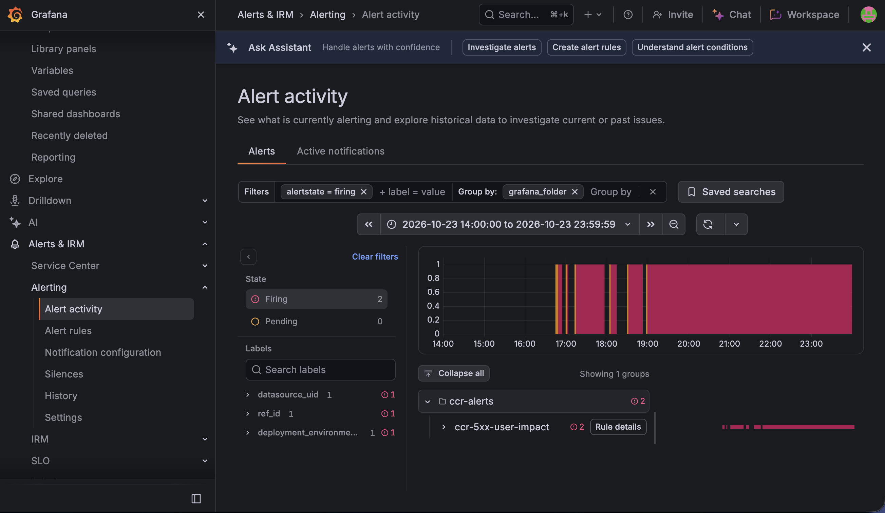
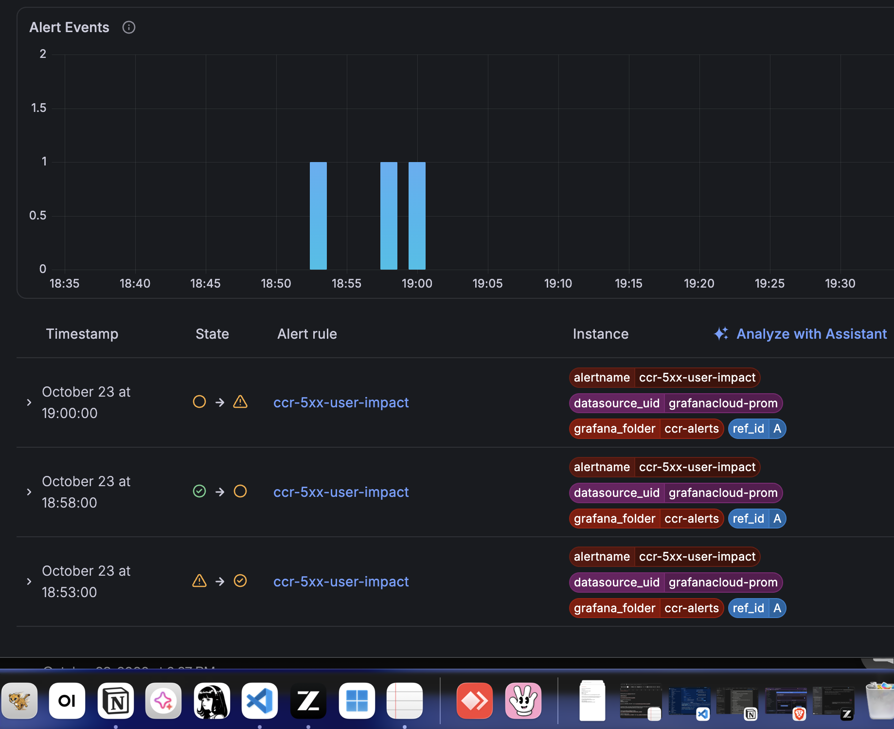
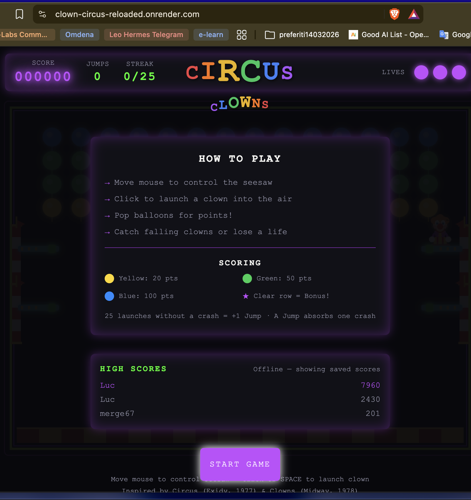
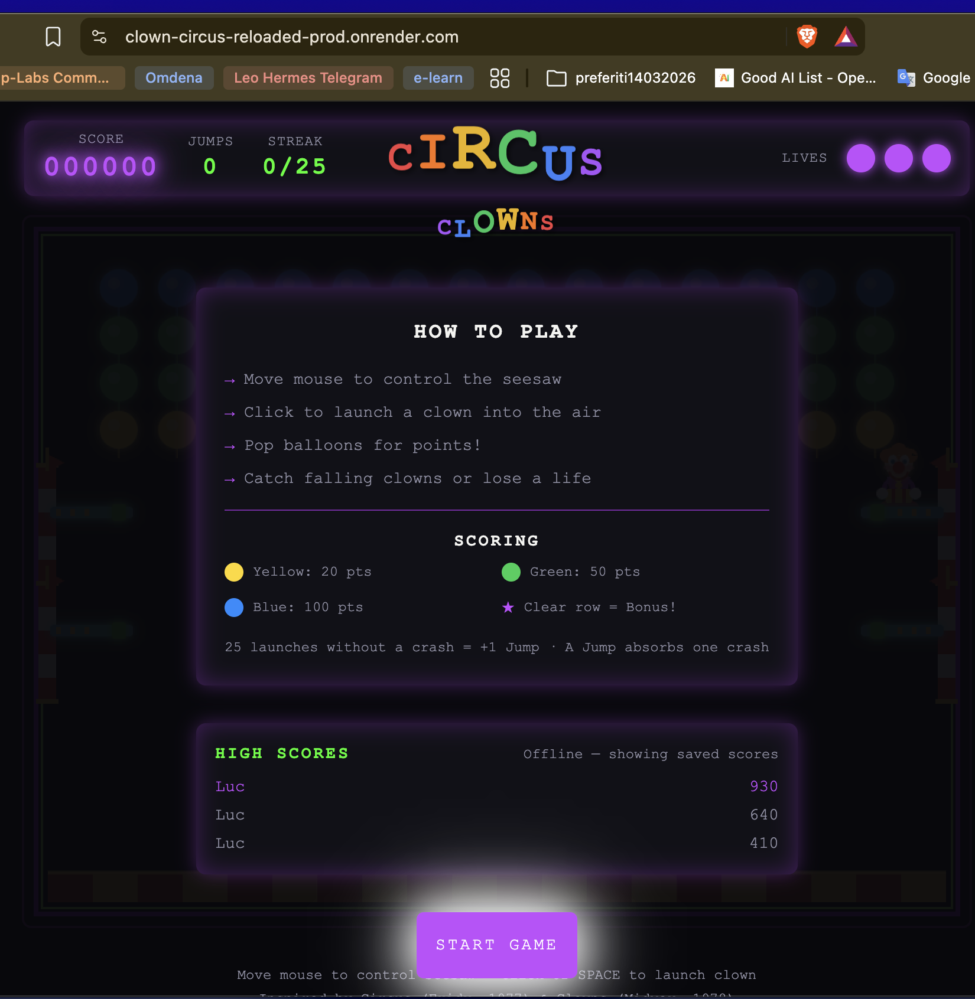
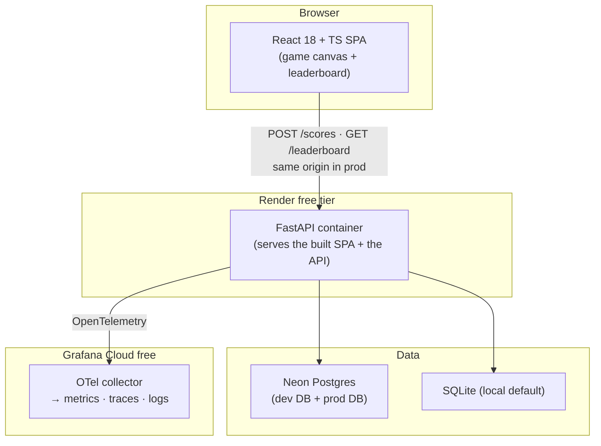

[](https://github.com/lucapug/clown-circus-reloaded/actions/workflows/ci.yml)
# Clown Circus Reloaded

Clown Circus Reloaded is a browser remake of the 1970s arcade classics *Circus* (Exidy, 1977) and *Clowns* (Midway, 1978) — launch clowns from a seesaw to pop rows of balloons, rack up points, survive level after level of increasing speed — wrapped in a full-stack web application with a shared, persistent leaderboard. It is also a capstone project for the AI Dev Tools Zoomcamp 2026: the whole system was specified, built, tested, deployed, and operated by a team of AI agents working through a graph loop, with a human owner reviewing and merging everything.

**Try it live** (free-tier hosting — the first request after a quiet period may take up to ~45 s to wake):

- **Production:** https://clown-circus-reloaded-prod.onrender.com
- **Development:** https://clown-circus-reloaded.onrender.com

## Demo

Play it: **[production](https://clown-circus-reloaded-prod.onrender.com)** · **[development](https://clown-circus-reloaded.onrender.com)** (free tier — the first request after a quiet period may take up to ~45 s to wake).

**[Gameplay video (~35 s, shot on production)](docs/demo/demo-video.mp4)** — the course's two-session verification ritual in one take: play → game over → submit the name → the entry visible on the leaderboard.


*Mid-game on production — clown in flight, HUD visible (score / lives / level). The near-parity 2025 gameplay, rebuilt.*


*The `ccr-journey` dashboard in Grafana Cloud — per-endpoint request rate, duration (p95), and errors for the key user journey, grouped by environment (the environment filter dropdown is visible top-left).*


*The `ccr-env-version` dashboard — every deploy appears as a new `service_version` line, so a regression can be pinned to the exact deploy.*


*The 5xx alert `ccr-5xx-user-impact` firing during the M5 on-call drill (dev) — sustained server errors on the user-impact write path.*


*The alert's state history — the fire-and-clear record on real traffic.*


*The shared leaderboard on the development environment.*


*The shared leaderboard on production — same game, separate database.*

*A note on provenance: this project deliberately reimplements [Clown Circus Carnival](https://github.com/lucapug/clown-circus-carnival), my 2025 capstone for the course's first edition — same game, profoundly different method. The 2025 project manually orchestrated LLMs in assigned roles; this one is built with the AI-native engineering practices established over the past year (specifications, loops, graphs, subagents, CI/CD, observability — the 2026 edition's toolbox), applied and evaluated throughout the [project diary](_docs/diary.md).*

## Problem

You control a seesaw. Two clowns take turns: one bounces on the seesaw, the other is launched skyward toward a grid of balloons — 4 rows × 14 balloons, each row worth more than the last (20 / 50 / 50 / 100 points, with row-clear bonuses of 200 / 500 / 500 / 1000). Pop balloons, clear rows, bank extra jumps, and keep both clowns alive: a clown that misses the seesaw costs a life. Each level adds speed (+25% velocity) and grants a life; the launch velocity itself grows with every launch and resets on death — so the game gets harder the better you play.

The scoreboard is the point: every game ends with a name entry and a place on a leaderboard shared by everyone playing on that environment. When the save fails (offline, server hiccup), the game is honest about it — the score is queued locally and synced later, never silently lost.

Who it is for: players who enjoy short-session, skill-based arcade games with a persistent scoreboard (desktop, mouse + click/SPACE — no touch support yet), and — as the second face of the project — anyone interested in how a full-stack application is built end-to-end by an AI agent team under real engineering constraints (specs, tests, CI/CD, observability, on-call). The game is the workload; the AI-native process is the subject. [`product-spec.md`](product-spec.md) pins every game constant; [`_docs/2025-baseline-vs-2026-opportunities.md`](_docs/2025-baseline-vs-2026-opportunities.md) tells the story of the 2025 predecessor this project remakes.

## Testing

From the repo root. Prerequisites: Node 22 (see [`.nvmrc`](.nvmrc)), [`uv`](https://docs.astral.sh/uv/) for Python, Docker, bash, curl. First-time setup: `npm install` (root) and `cd backend && uv sync`.

```bash
npm test   # the unit command — this is what CI gates on
```

One command runs both unit suites: frontend vitest (**252 passed | 6 skipped** — the skips are env-gated live-integration and CLI replay tests) and backend pytest (**49 passed**), in parallel, hermetic (mocked I/O, per-test SQLite temp files), in under ~2 minutes.

Beyond units, three more batteries (documented local, not in CI — a deliberate, recorded decision):

- **`npm run test:integration`** — boots the real stack in an isolated Compose project (`clown-circus-it`, loopback-only ports 18000/15432), waits for `/health`, runs the live leaderboard integration tests against real HTTP, then runs the full backend suite against the Compose Postgres — proving the suite passes identically on SQLite and Postgres. Tears itself down even on failure (~2–6 min).
- **`cd frontend && npm run test:e2e`** — the Playwright happy path: load → play via the dev-only `window.__game` hooks (seeded reset, tick fast-forward, forced game-over) → submit a unique name → assert the entry on the leaderboard via the real API. One scenario, `retries: 1`, `workers: 1` — the flake budget for a canvas game. A mechanism check: gameplay acceptance stays with human play sessions.
- **`cd frontend && npm run test:prod-gating`** — rebuilds the production bundle and greps it for the E2E debug hooks: zero matches, i.e. compile-time proof that `window.__game` never ships to production.

Why units-only CI: the integration and E2E batteries need Docker Compose and a dev server; running them on every PR was traded against flake risk and runner time, and the trade-off is recorded (issue #45). Everything above runs with a single command on any machine.

## Monitoring

The application emits OpenTelemetry signals (metrics, traces, structured logs sharing a trace ID) from both environments to **Grafana Cloud** (the free tier — the course's sanctioned managed-service shortcut for this stack; no self-hosted observability needed). Two dashboards are provisioned as code from [`ops/grafana/`](ops/grafana/):

- **`ccr-journey`** — the key user journey: per-endpoint request **rate**, **duration (p95)**, and **error rate** for `POST /scores` and `GET /leaderboard`, each grouped by environment (dev/prod); plus log and trace panels where every log line links to its trace (and every trace exemplar links back to logs) via trace-ID correlation. What the panels tell you: whether score saves and leaderboard reads are fast and succeeding, separately per environment — the exact user-impact surface.
- **`ccr-env-version`** — every deploy appears as a new `service_version` line: request rate per version, so a regression can be pinned to the exact deploy that introduced it.

Viewing them requires the project's Grafana Cloud account (observability services stay authenticated — nothing is exposed publicly); the Demo section above carries screenshots of both dashboards, and a 5xx **alert** (`ccr-5xx-user-impact`) emails on sustained server errors per environment — fired and resolved on real traffic during the M5 drill (diagnosed end-to-end by an **AI on-call agent** paged with the alert text only, its smallest-fix PR human-reviewed), with the full record in [`docs/agent-work-evidence.md`](docs/agent-work-evidence.md) and [`_docs/diary.md`](_docs/diary.md).

## Quickstart

The recommended setup is the single-container Compose stack (prerequisite: [Docker](https://docs.docker.com/get-docker/) only):

```bash
git clone https://github.com/lucapug/clown-circus-reloaded.git
cd clown-circus-reloaded
docker compose up -d --build
```

Then open <http://localhost:8000> and play. Optional verify line:

```bash
curl http://localhost:8000/health        # -> {"status":"ok"}
```

…and the full ritual: play a game, submit a score, see yourself on the leaderboard at <http://localhost:8000>. The Compose `db` service runs Postgres 15 with dev-only credentials (already wired via `DATABASE_URL` — nothing to configure); stop and remove everything including data with `docker compose down -v`.

For frontend development with hot reload instead: `cd frontend && npm install && npm run dev` works with **zero backend** (the leaderboard mock is on by default in `.env.development`). To develop against a live API, see [AGENTS.md](AGENTS.md) ("Leaderboard service modes") — the normative write-up.

## Data and configuration

Four environment variables, all optional (every default works). Copy-paste starting points: [`backend/.env.example`](backend/.env.example) and [`frontend/.env.example`](frontend/.env.example).

| Variable | Where read | Required | Default | Purpose |
|---|---|---|---|---|
| `DATABASE_URL` | backend (`app/config.py`) | no | `sqlite:///./clowncircus.db` | Postgres connection string in the cloud (Neon); plain `postgres://` schemes are normalized automatically. Local default = SQLite file. |
| `CORS_ORIGINS` | backend (`app/config.py`) | no | `http://localhost:5173`, `http://127.0.0.1:5173` | Allowed origins for the Vite dev server. |
| `VITE_USE_MOCK_LEADERBOARD` | frontend | no | unset (= real HTTP service) | `1` = zero-backend mock leaderboard (the default in `.env.development` for backend-free dev). |
| `VITE_API_BASE_URL` | frontend | no | `''` (same-origin) | Explicit API base for split dev setups (e.g. `http://127.0.0.1:8000`); production serves frontend and API from one origin. |

No secrets are needed to run locally. The deployed environments carry one secret each (`DATABASE_URL`) in platform secret storage — never in the repo; the [`ops/dev-deploy-runbook.md`](ops/dev-deploy-runbook.md) AC2 check greps the tree to prove it.

## Deployment

Both environments run on **Render** (free tier, Frankfurt) against **Neon** Postgres (free), from immutable images on GHCR — a €0 stack, chosen deliberately over AWS for this project (cost rationale in `_docs/plan.md` §2, D6).

How deployment works: every PR runs CI (tests, audits, image build); every merge to `main` is **automatically deployed to dev** (build once → push `ghcr.io/lucapug/clown-circus-reloaded:<YYYYMMDD-HHMMSS>-<sha>` → Render API deploy → poll to live → exact-body `/health` check). **Production is never auto-deployed**: it advances only by an explicit, human-dispatched promotion that deploys the *same image dev already validated*, pinned by **digest** — stricter than tag-based promotion (GHCR tags are mutable; digests are not), implementing "promote exactly the artifact validated in dev". Rolling back prod = re-run the promotion with the previous tag+digest — demonstrated live in the #60 rollback drill (record in [`ops/dev-deploy-runbook.md`](ops/dev-deploy-runbook.md), "Rollback drill record").

To deploy your own copy: the full runbook — Render/Neon setup, GHCR, API keys, the promotion dispatch, health monitoring — is [`ops/dev-deploy-runbook.md`](ops/dev-deploy-runbook.md), written to be reproducible from zero. Security posture: `pip-audit`, `npm audit`, and `gitleaks` run in CI on every PR (visible in the badge above), milestone security reviews are recorded in the diary, and no customer data or credentials ever enter telemetry signals (a backend test enforces it).

## Architecture



Why each piece: one container serves both the built SPA and the API (the course's single-container pattern — no separate static hosting, one thing to deploy and roll back; two-stage Docker build: Node build → slim Python runtime). The game core is pure TypeScript (seeded RNG, fixed 60 Hz ticks) behind a thin React/canvas shell — which is what makes the game deterministic and the E2E hooks possible. The backend is FastAPI + SQLAlchemy against Postgres in the cloud and SQLite locally, selected through one `DATABASE_URL`. Telemetry flows from both environments into Grafana Cloud, where the dashboards and the 5xx alert live. CI/CD (GitHub Actions) closes the loop: merge → dev deploy → validated → digest-pinned promotion → prod.

Repository layout, one line each: [`frontend/`](frontend) (game + UI, Vite) · [`backend/`](backend) (FastAPI app + tests) · [`ops/`](ops) (deploy runbook, Compose test stacks, Grafana-as-code) · [`docs/`](docs) (agent evidence, permissions, extension pack) · [`_docs/`](_docs) (process, plan, diary) · [`product-spec.md`](product-spec.md) + [`openapi.yaml`](openapi.yaml) (the contract pair).

## Decisions and trade-offs

The full decision log is [`_docs/plan.md`](_docs/plan.md) §2 (D1–D11); the ones that shape what you see:

- **In-harness AI generation over a UI generator** (D4): the 2025 predecessor used Lovable.dev for the MVP; this project builds everything inside the coding-agent harness. Downside: no instant visual drafts. Accepted: architecture, tests, and process are the point.
- **Free-tier Render + Neon + GHCR over AWS** (D6): chosen when the course's own deployment guidance flagged cloud costs; downside: cold starts (~45 s after idle) and instance-hour caps; accepted: €0 total, health-monitor keep-warm, and cold-start is cosmetic.
- **Deterministic game core over engine/physics library** (D5): seeded RNG + fixed ticks make gameplay acceptance criteria arithmetic, not vibes; downside: hand-rolled physics; accepted: testability and parity with the 2025 baseline.
- **Full agent graph on every issue** (D3): PM → engineer → QA + reviewer, human merges — knowingly overkill for small tasks; downside: token cost (measured: ≈68.9M subagent tokens across cycles #19–#32, diary ledger); accepted: independent verification caught real defects pre-merge (evidence: [`docs/agent-work-evidence.md`](docs/agent-work-evidence.md)).
- **Units-only CI gate** (#45 recorded): integration/E2E stay single-command local; downside: less automation before merge; accepted: flake budget on a canvas game, documented parity runs.
- **Private during development, public at submission** (D11): the tracker and evidence go public only when the submission is pinned; downside: reviewers can't watch live; accepted: clean history, one flip at the end.

## How this was built (AI usage)

The project applies the course's four levels of AI-native engineering — **prompt engineering** (role files with explicit boundaries), **context engineering** (this README's siblings: [`AGENTS.md`](AGENTS.md) → modular [`_docs/`](_docs) with progressive loading), **loop engineering** (each issue a groomed task with a model-checkable Definition of Done), and **graph engineering** (the PM → engineer → QA + reviewer pipeline with FAIL routed back, run as an orchestrated loop — orchestrator-driven, not `/goal`-automated).

Every unit of work flowed through that graph: a PM agent turns a groomed issue into a self-contained brief; an engineer implements it as one PR (smoke-verified); QA independently re-runs the full acceptance battery; a reviewer reads the diff against the brief — and the human owner merges. All agent output is posted through the owner's account with **structural attribution** (role-file SHAs in comment headers, `Assisted-by:` trailers on commits) so any reader can verify who did what: the how-to-verify guide is [`docs/agent-work-evidence.md`](docs/agent-work-evidence.md); the per-role boundaries and permission model are [`docs/permissions.md`](docs/permissions.md); the reusable pack (role definitions, the distilled promotion skill, adoption steps) is [`docs/agent-extension-pack.md`](docs/agent-extension-pack.md). The complete, honest record — including every rework, timeout, provider outage, and token ledger — is the project diary: [`_docs/diary.md`](_docs/diary.md).

The build itself followed the course's incremental arc — specification → frontend with mock services → contract → backend → persistence → deploy → observability — and **each step ended with something functioning** (spec approved, mock playable, contract green, API live, and so on; the diary's cycle entries are the receipts). The role files are living documents: when a process defect was found (a vacuous build gate, browser-automation overreach), the fix landed in the role file itself — `.agents/agents/engineer.md` and `qa.md` carry those corrections today.

## Limitations

Named boundaries, with their practical consequences:

- **Free-tier cold start**: after ~15 idle minutes the services sleep; the first request takes up to ~45 s (measured: 43 s). The scheduled health monitor keeps them mostly warm; the leaderboard UI falls back to its cached copy while waking.
- **Transient first-write failures after idle** (issue [#66](https://github.com/lucapug/clown-circus-reloaded/issues/66)): **fixed post-submission** — the engine pool now uses pre-ping, so a pooled connection gone stale across an idle wake is detected at checkout and re-established transparently; the game-over score POST no longer 500s after idle. The free-tier wake latency itself is unchanged (see **Free-tier cold start** above).
- **A stranded-clown edge case** (issue [#57](https://github.com/lucapug/clown-circus-reloaded/issues/57)): a board clown can stop at vx≈0 (no slide, no fall) until the next launch; the game stays playable. Awaiting a recorder trace from the owner; fix-vs-version-2 is an open call.
- **Desktop only**: mouse + click/SPACE; no touch support. **E2E hooks are dev-only** (proven absent from production builds by `npm run test:prod-gating`).
- **One user account**: all agent work is posted through the owner's GitHub account — attribution is structural (headers/trailers), not account-based (disclosed in the evidence doc).

## Future work

From the recorded WONT-v1 list (second-attempt candidates, prioritized): the #66 pool fix and #57 resolution first; then mobile/touch input, the trampoline "skating" edge case (owner gameplay call), sprite rotation in flight, level-up celebration pause, deeper dashboards, extended E2E scenarios, `/loop` automation over the backlog, parallel-worktree cycles, and a token-compression trial. The full list with rationale: [`_docs/plan.md`](_docs/plan.md) §6.

## Self-evaluation

A criterion-by-criterion self-assessment against the course rubric (score + evidence link per criterion) is at [`docs/self-assessment.md`](docs/self-assessment.md).
<!-- TODO(owner, M7 #69): verify link resolves before D11 flip -->

## Documentation map

| Doc | What it holds |
|---|---|
| [`product-spec.md`](product-spec.md) | The approved product specification (every game constant pinned) |
| [`openapi.yaml`](openapi.yaml) | The API contract of record |
| [`AGENTS.md`](AGENTS.md) | Working instructions for coding agents (commands, testing, context) |
| [`docs/agent-work-evidence.md`](docs/agent-work-evidence.md) | How to verify the agents really did the work (attribution, causal chains) |
| [`docs/permissions.md`](docs/permissions.md) | Who writes what: the per-role permission model |
| [`docs/agent-extension-pack.md`](docs/agent-extension-pack.md) | The reusable agent-team pack (roles, skill, lifecycle, adoption) |
| [`docs/runbook.md`](docs/runbook.md) | Alert semantics and probe protocol records |
| [`ops/dev-deploy-runbook.md`](ops/dev-deploy-runbook.md) | Reproduce the deployment from zero; rollback; API semantics |
| [`_docs/plan.md`](_docs/plan.md) · [`_docs/process.md`](_docs/process.md) · [`_docs/diary.md`](_docs/diary.md) | Plan & decisions · working principles · the daily record |
