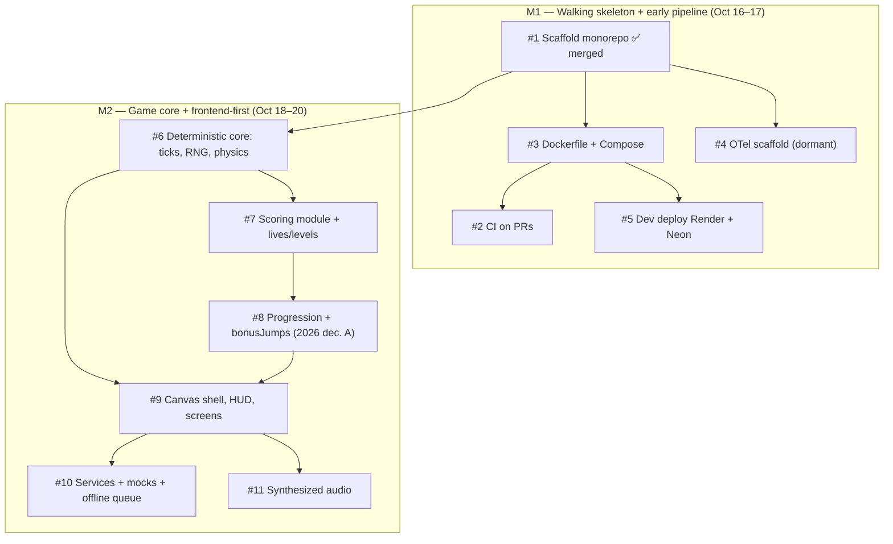

# Backlog Map — Issue Dependency Graph

**Purpose:** read-only visualization of the groomed backlog's dependency DAG. The canonical task state lives in **GitHub Issues** (plan decision D2); this map is an index, not a second backlog. Regenerate it whenever issues are added, split, or re-linked.

**Snapshot date:** 2026-10-15, updated after PR #12 merged (#1 ✅) and the #3 → #2 dependency reconciliation (issue #2's Docker-build job needs #3's Dockerfile). M3–M7 issues are added as their milestones enter grooming.

**Critical path (longest chain):** #1 → #6 → #7 → #8 → #9 → #10 — the sequence the C1 checkpoint (Oct 21 EOD, plan §6) effectively watches; slippage here triggers the ordered cut list.

**Parallelism available:** after #1 landed, #3 and #4 are independent; #2 follows #3 (Docker-build job). After #9 lands, #10 and #11 are independent. These are the natural candidates for the worktree/parallelism experiments (deferred by default, plan §6 WONT v1).
