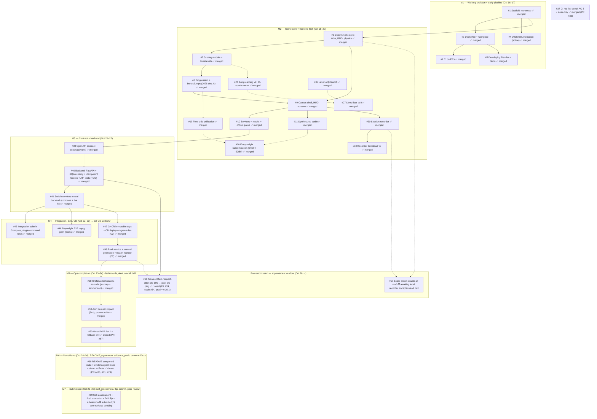

# Backlog Map — Issue Dependency Graph

**Purpose:** read-only visualization of the groomed backlog's dependency DAG. The canonical task state lives in **GitHub Issues** (plan decision D2); this map is an index, not a second backlog. Regenerate it whenever issues are added, split, or re-linked.

**Snapshot date:** 2026-10-26 (evening) — **M0–M7 COMPLETE; project SUBMITTED** (pin `88d7593` = tag `v1.0.0`). Post-submission improvement window open: **#66 closed** via PR #74 (cycle #34) and promoted to prod as **`v1.0.1`** (`63dd895`); open by choice: #69 (3 peer reviews pending), #57 (awaiting a local recorder trace).

**Critical path (longest chain):** #1 → … → #48 → #58 → #59 → #60 → #68 → #69 — **fully executed**: M5 complete Oct 24 (#60 via PR #67), M6 complete Oct 26 (#68 via PRs #70/#71/#73), M7 submitted Oct 26 (self-assessment PR #72, digest-gated final promotion, D11 public flip, platform submission; pin `88d7593` = `v1.0.0`). #69 stays open until the owner's 3 mandatory peer reviews are done (assignments expected from Oct 27).

**Post-submission window:** #66 (the real prod incident found on drill day) was fixed through the full graph loop (cycle #34: PM brief → engineer PR #74 → independent QA + reviewer → supplemental QA with a real-pool proof), merged by the owner, validated on dev by real play, promoted to prod (run 40385200984, digest-gated) and accepted on prod by real play; tagged `v1.0.1` on `63dd895`. #57 depends on a recorder trace that can only be captured in a local `npm run dev` session (the recorder is DEV-gated and absent from deployed bundles); the fix-vs-v2 decision follows the trace. Dotted edges: #66 surfaced through the prod service of #48 and lands in the #40 DB layer; #57 lives in the #6 physics core and is evidenced through the #30 recorder.

**Parallelism available (M4):** #45, #46 and #47 are mutually independent once #41 is merged; #48 waits for #47. Owner-side platform steps for #47/#48 (Render API key/deploy hook, prod Neon database, prod service) can start before the agent cycles.

**Parallelism available:** after #1 landed, #3 and #4 are independent; #2 follows #3 (Docker-build job). After #9 lands, #10 and #11 are independent. These are the natural candidates for the worktree/parallelism experiments (deferred by default, plan §6 WONT v1).
