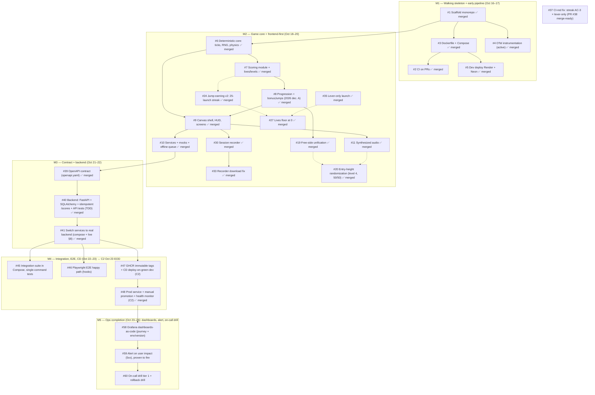

# Backlog Map — Issue Dependency Graph

**Purpose:** read-only visualization of the groomed backlog's dependency DAG. The canonical task state lives in **GitHub Issues** (plan decision D2); this map is an index, not a second backlog. Regenerate it whenever issues are added, split, or re-linked.

**Snapshot date:** 2026-10-23 — M2/M3/M4 complete, **C2 achieved 2026-10-22 (one day early)**, **M5 groomed (#58–#60)**. M6/M7 issues are added as their milestones enter grooming.

**Critical path (longest chain):** #1 → … → #41 → #47 → #48 → **#58 → #59 → #60** — C2 ACHIEVED 2026-10-22 (one day early: CD green on dev + manual promotion to prod demonstrated). M5 (5 graded points) is now the critical path toward the Oct-26 submission; #45/#46 merged closed M4 4/4.

**Parallelism available (M4):** #45, #46 and #47 are mutually independent once #41 is merged; #48 waits for #47. Owner-side platform steps for #47/#48 (Render API key/deploy hook, prod Neon database, prod service) can start before the agent cycles.

**Parallelism available:** after #1 landed, #3 and #4 are independent; #2 follows #3 (Docker-build job). After #9 lands, #10 and #11 are independent. These are the natural candidates for the worktree/parallelism experiments (deferred by default, plan §6 WONT v1).
