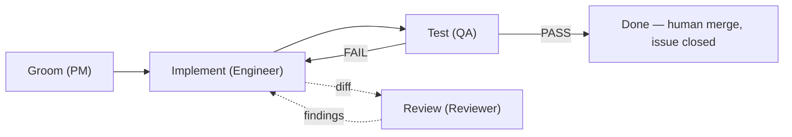

# Agent Extension Pack — the reusable agent-team artifacts

This repository is built by a graph loop of AI agent roles. This page
packages the reusable parts — role definitions, the one skill, the
orchestration process, and adoption steps — so another project can adopt
the pattern without reading our whole diary. The structure follows the
course's four building-block pillars (*Coding Agent Building Blocks:
Reusable Skills and Specialized Subagents*, `docs/course_KB/04…pdf`,
pp.4–18), with the orchestration lifecycle from *AI-Native Development:
Specifications, Loop and Graph Engineering* (`docs/course_KB/02…pdf`,
pp.19–22). KB pages are cited rather than re-pasted; the one mandated
verbatim mirror (the orchestrator Rules list) lives in
[`docs/permissions.md`](permissions.md).

## 1. Subagent definitions ([04] pp.10–14)

Each role is a markdown file with YAML frontmatter — `name:` +
`description:`, the discoverable-definition convention ([04] p.13) —
followed by the authoritative charter: boundaries, procedure, anti-hang
rules, escalation protocol, comment/verdict formats. The files are
versioned in git and committed **before** the comments that follow them;
cycle prompts carry only issue/PR identifiers and cycle-specific deltas
(`_docs/process.md` §8).

Discovery convention ([04] p.13): definitions live at
`.agents/agents/<NAME>.md` and are launched by name.

| Definition | `name:` | Charter (what the body pins) |
|---|---|---|
| [`.agents/agents/pm.md`](../.agents/agents/pm.md) | `pm` | grooms one issue into a self-contained implementation brief — the cycle's single source of truth |
| [`.agents/agents/engineer.md`](../.agents/agents/engineer.md) | `engineer` | implements exactly the brief, one PR, smoke-only verification, PR body as its only human channel |
| [`.agents/agents/qa.md`](../.agents/agents/qa.md) | `qa` | independent full Definition-of-Done re-run; exactly one PASS-or-FAIL verdict comment; read-only |
| [`.agents/agents/reviewer.md`](../.agents/agents/reviewer.md) | `reviewer` | independent diff review; verdict formed before reading QA's verdict |
| on-call (ad-hoc, issue #60 drill) | — | no role file: a drill-only role paged with the alert text only; diagnosis comment + smallest-fix PRs, never merges |

The two-reader design (QA + reviewer with separate lenses) and the
permission boundaries each role operates under are consolidated in
[`docs/permissions.md`](permissions.md).

## 2. Skills ([04] pp.4–9)

A skill is a structured set of instructions for a repeatable procedure
([04] p.4): `.agents/skills/<NAME>/SKILL.md` with frontmatter `name:` +
`description:` — and that is the whole convention ([04] p.7); the rest of
the body is the author's.

**Inventory (one real skill):**

- [`.agents/skills/prod-promotion/SKILL.md`](../.agents/skills/prod-promotion/SKILL.md)
  — distills the digest-gated prod promotion and its rollback from
  `ops/dev-deploy-runbook.md` (the runbook stays the primary source; the
  skill is the agent-facing entry point).

**Creation method ([04] p.9):** do the task with the agent first, correct
it, then save the corrected workflow as a skill. Applied here literally:
the promotion procedure was executed repeatedly before being distilled —
the first demonstrated promotion ([run 39777647379](https://github.com/lucapug/clown-circus-reloaded/actions/runs/39777647379), 2026-10-22)
and the three-dispatch rollback drill (2026-10-23, recorded in the
runbook) — so the skill encodes a walked path, not a designed one.

**Why only one skill:** procedures stay as runbook-style docs until they
repeat. The #60 on-call drill deliberately did **not** become a skill — a
drill is an incident record (what happened), a skill is a prescription
(what to do); the drill's repeatable half, the promotion/rollback
mechanism, is what the one skill captures.

## 3. Process / orchestration ([02] pp.19–22, [04] pp.14–17)

The main session is the orchestrator: it launches the roles as subagents
and does not groom, implement, or test itself ([02] p.21). The lifecycle
([02] pp.21–22), as this repo actually runs it:

1. **Pick the next open issue from the backlog** — GitHub Issues are the
   canonical backlog; the dependency DAG map is `_docs/backlog.md`.
2. **PM grooms it** — one self-contained brief comment on the issue.
3. **Engineer implements it** — one branch, one PR, smoke verification
   only (the full battery is QA's).
4. **QA verifies it** — independent full DoD re-run → PASS or FAIL; the
   reviewer reviews the diff independently in the same window, verdict
   formed before reading QA's.
5. **On FAIL, back to step 3** with the QA comment as input — findings
   route via the orchestrator; [minor]/mechanical fixes may go to a fresh
   mini-agent instead of a full engineer resume (`_docs/graph-tuning.md`
   P1.4).
6. **On PASS, close the issue** — after the human owner reviews and
   merges the PR (plan §2 D3); the orchestrator manages the
   `in-progress` label at cycle boundaries.
7. **Repeat until the backlog is empty.**

The governing orchestrator Rules list is mirrored verbatim and annotated
per rule in [`docs/permissions.md`](permissions.md) ([02] pp.21–22).

The workflow as a graph ([02] p.20, [04] p.15):

The solid path is the course's Groom → Implement → Test → Done with the
FAIL back-edge; the dotted side-path is this repo's addition (the
independent reviewer), and the Done node absorbs the human merge
authority (D3).

## 4. Adoption steps for a new project ([02] p.8, [04] pp.8–9)

1. Write `AGENTS.md` at the repo root — the commands and working rules
   every assistant reads at session start.
2. Stay tool-agnostic: create `CLAUDE.md` containing the single line
   `@AGENTS.md` ([02] p.8), so Claude Code reads the same context file as
   the other coding assistants.
3. Define role files in `.agents/agents/<NAME>.md` with `name:` +
   `description:` frontmatter ([04] p.13); keep the bodies authoritative
   and version them in git.
4. Describe the process in a document the orchestrator follows —
   lifecycle plus rules ([02] p.21; ours: `_docs/process.md` §8, linked
   from `AGENTS.md`).
5. Distill repeatable procedures into skills at
   `.agents/skills/<NAME>/SKILL.md` — after doing the task, not before
   ([04] p.9).
6. Choose placement per [04] pp.8–9: project-specific by default
   (`.agents/skills/` and `.agents/agents/` inside the repo); global
   locations (`~/.codex/skills/`, `~/.claude/skills/`) only for skills
   every project on the machine needs. All of ours are project-specific.
7. Launch the loop from a fresh session and let the main session
   orchestrate ([02] p.21, [04] p.14). Here that meant orchestrator-driven
   graph cycles with a human approver/merger (plan §2 D3) — no
   unattended, `/goal`-style automation was used, and none should be
   claimed.
8. Measure and tune from the first cycle: per-pass token ledgers, a
   verdict-integrity checklist, and fixes applied at the role-file source
   (`_docs/graph-tuning.md`; the living-document pattern).

### Attribution convention

Every agent comment on GitHub starts with a visible header —
`[ROLE · role file <name>.md@<sha> · posted-by lucapug, content authored by the <role> agent]` — and role-authored commits carry the Git trailer
`Assisted-by: ZCode-<role>` (owner-approved 2026-10-17). Ad-hoc roles get
an ad-hoc header: the #60 drill's on-call artifacts carry
`**[ON-CALL · ad-hoc drill role, issue #60 · posted-by lucapug, content authored by the on-call agent]**`. All content is posted through the
single owner account; `docs/agent-work-evidence.md` indexes the
structural evidence that the formats were versioned before use.

## Why a graph here

[02] p.22 warns that this approach "takes significantly more time and
tokens than a direct loop with only a software engineer" and that "often,
a simple prompt or loop is enough" — the graph was worth it here because
the graded artifact was the development process itself, and independent
verification caught real defects a single session would have averaged
away (the vacuous smoke in [PR #44](https://github.com/lucapug/clown-circus-reloaded/pull/44), the false-provenance tag in
[PR #49](https://github.com/lucapug/clown-circus-reloaded/pull/49)), bought knowingly at ≈66.9M measurable subagent tokens over cycles
#19–#31 (diary ledger).
